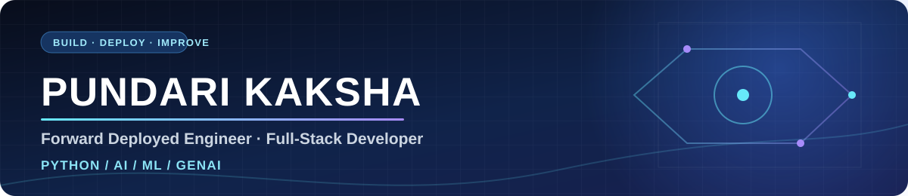

<!-- Profile README · github.com/Pundarikaksha1 -->

  
   
  
<strong>Building software for real-world problems · Python · AI/ML · GenAI</strong>

    
  
  
  

 

## 01 · About me

I'm **Pundari Kaksha**, a developer focused on **forward deployed engineering** and building practical full-stack products. I enjoy turning real user needs into clear workflows, working software, and thoughtful AI integrations. My **Human Genetics** background has also shaped my interest in healthcare technology.

> **My approach:** Understand the problem → build the product → integrate the data → test with users → improve.

## 02 · Technologies

  <h4>Languages &amp; web</h4>
  
  <h4>Frontend &amp; backend</h4>
  
  <h4>Data, deployment &amp; tools</h4>
  

## 03 · AI, ML &amp; GenAI

I’m interested in bringing intelligent features into useful products, with attention to evaluation, human review, and real-world limitations.

| Area | What I’m working on |
| :--- | :--- |
| **Artificial intelligence** | AI-assisted application workflows and responsible integration into products. |
| **Machine learning** | Model evaluation, data quality, and interpreting predictions in context. |
| **Generative AI** | Exploring LLM APIs, prompt design, retrieval, and useful product experiences. |

  
  
  
    
  Exploring and learning: ML frameworks, LLM application patterns, and AI evaluation.
   
  

## 04 · Featured project

### 🩺 [Aarogya Drishti](https://github.com/Pundarikaksha1/Aarogyadrishti)

A multilingual **screening-to-care prototype** supporting registration, clinician review, referrals, and follow-up. Built with **React, TypeScript, Vite, Node.js, Supabase, and PostgreSQL**. The AI-assisted screening work is at a **research stage** and remains subject to clinician review.

[View the repository →](https://github.com/Pundarikaksha1/Aarogyadrishti)

## 05 · Certificates

Course completion certificates issued by **Fynity Innovations LLP** in November 2026.

| Area | Certificates (PDF) |
| :--- | :--- |
| **Generative AI** | [Generative AI Fundamentals](https://github.com/Pundarikaksha1/Pundarikaksha1/blob/main/certificates/generative-ai-fundamentals.pdf) · [Generative AI](https://github.com/Pundarikaksha1/Pundarikaksha1/blob/main/certificates/generative-ai.pdf) · [Prompt Engineering](https://github.com/Pundarikaksha1/Pundarikaksha1/blob/main/certificates/prompt-engineering.pdf) · [Multimodal Generative AI](https://github.com/Pundarikaksha1/Pundarikaksha1/blob/main/certificates/multimodal-generative-ai.pdf) |
| **LLM engineering** | [LLM & Transformers](https://github.com/Pundarikaksha1/Pundarikaksha1/blob/main/certificates/llm-and-transformers.pdf) · [LLM Application Development](https://github.com/Pundarikaksha1/Pundarikaksha1/blob/main/certificates/llm-application-development.pdf) · [Embeddings, Vector Databases & RAG](https://github.com/Pundarikaksha1/Pundarikaksha1/blob/main/certificates/embeddings-vector-databases-and-rag.pdf) · [Fine-Tuning & LLM Adaptation](https://github.com/Pundarikaksha1/Pundarikaksha1/blob/main/certificates/fine-tuning-and-llm-adaptation.pdf) · [GenAI Evaluation & Production](https://github.com/Pundarikaksha1/Pundarikaksha1/blob/main/certificates/genai-evaluation-and-production.pdf) |
| **Full-stack development** | [HTML](https://github.com/Pundarikaksha1/Pundarikaksha1/blob/main/certificates/html.pdf) · [CSS](https://github.com/Pundarikaksha1/Pundarikaksha1/blob/main/certificates/css.pdf) · [JavaScript](https://github.com/Pundarikaksha1/Pundarikaksha1/blob/main/certificates/javascript.pdf) · [MERN with AI](https://github.com/Pundarikaksha1/Pundarikaksha1/blob/main/certificates/mern-with-ai.pdf) |
| **Data & algorithms** | [Structured Query Language (SQL)](https://github.com/Pundarikaksha1/Pundarikaksha1/blob/main/certificates/structured-query-language.pdf) · [Data Structures and Algorithms (DSA)](https://github.com/Pundarikaksha1/Pundarikaksha1/blob/main/certificates/data-structures-and-algorithms.pdf) |

## 06 · Connect

  
<strong>Have a real-world problem worth solving? Let's connect.</strong>

  
  
    

